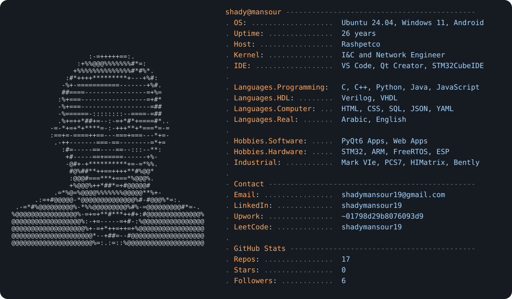

  

  

  
  
  
  
  
  
  

---

### 👋 About me

I'm an **Instrumentation, Control & Network Engineer** in oil & gas, with an **embedded systems** background and a habit of building software for the problems I see in the field: permits, handovers, timesheets.

- 🏭 Working on control, safety and fire & gas systems: GE Mark VIe, Siemens PCS7 / TIA Portal, Allen-Bradley, Bently Nevada 3500, HIMatrix, Det-Tronics
- 🔌 Embedded: STM32 / ARM Cortex-M, FreeRTOS, AVR, ESP8266, CAN / SPI / I²C / UART / Modbus
- 🖥️ Desktop & web apps in Python/Qt and JavaScript, freelancing on Upwork & Contra
- 💳 Working on a fintech contractor-financing platform at **Improvifi**
- 📍 Egypt

---

### 🛠️ Tech stack

**Core**
<table><tr>
<td align="center" width="90"> <small><small><small>C</small></small></small></td>
<td align="center" width="90"> <small><small><small>C++</small></small></small></td>
<td align="center" width="90"> <small><small><small>Python</small></small></small></td>
<td align="center" width="90"> <small><small><small>Java</small></small></small></td>
<td align="center" width="90"> <small><small><small>STM32</small></small></small></td>
<td align="center" width="90"> <small><small><small>Arduino</small></small></small></td>
<td align="center" width="90"> <small><small><small>VS Code</small></small></small></td>
<td align="center" width="90"> <small><small><small>Qt</small></small></small></td>
<td align="center" width="90"> <small><small><small>PostgreSQL</small></small></small></td>
<td align="center" width="90"> <small><small><small>Supabase</small></small></small></td>
</tr></table>

**Embedded &amp; HDL**
<table><tr>
<td align="center" width="145"> <small><small><small>ARM Cortex-M</small></small></small></td>
<td align="center" width="135"> <small><small><small>Embedded C</small></small></small></td>
<td align="center" width="100"> <small><small><small>FreeRTOS</small></small></small></td>
<td align="center" width="100"> <small><small><small>ESP8266</small></small></small></td>
<td align="center" width="70"> <small><small><small>AVR</small></small></small></td>
<td align="center" width="145"> <small><small><small>Verilog · VHDL</small></small></small></td>
<td align="center" width="195"> <small><small><small>CAN · I²C · SPI · UART</small></small></small></td>
</tr></table>

**Industrial &amp; networking**
<table><tr>
<td align="center" width="120"> <small><small><small>GE Mark VIe</small></small></small></td>
<td align="center" width="130"> <small><small><small>PCS7 / TIA Portal</small></small></small></td>
<td align="center" width="120"> <small><small><small>Studio 5000</small></small></small></td>
<td align="center" width="135">3500"/> <small><small><small>Bently Nevada 3500</small></small></small></td>
<td align="center" width="105"> <small><small><small>HIMatrix SIS</small></small></small></td>
<td align="center" width="135">F&amp;G"/> <small><small><small>Det-Tronics F&amp;G</small></small></small></td>
<td align="center" width="140"> <small><small><small>PROFIBUS · Modbus</small></small></small></td>
<td align="center" width="100"> <small><small><small>Cisco · VLANs</small></small></small></td>
</tr></table>

**OS &amp; tools**
<table><tr>
<td align="center" width="90"> <small><small><small>Linux</small></small></small></td>
<td align="center" width="90"> <small><small><small>Ubuntu</small></small></small></td>
<td align="center" width="90"> <small><small><small>Windows</small></small></small></td>
<td align="center" width="90"> <small><small><small>Bash</small></small></small></td>
<td align="center" width="90"> <small><small><small>Git</small></small></small></td>
<td align="center" width="90"> <small><small><small>GitHub</small></small></small></td>
</tr></table>

**Web**
<table><tr>
<td align="center" width="90"> <small><small><small>JavaScript</small></small></small></td>
<td align="center" width="90"> <small><small><small>HTML</small></small></small></td>
<td align="center" width="90"> <small><small><small>CSS</small></small></small></td>
<td align="center" width="90"> <small><small><small>Node.js</small></small></small></td>
<td align="center" width="90"> <small><small><small>React</small></small></small></td>
<td align="center" width="90"> <small><small><small>Vercel</small></small></small></td>
<td align="center" width="90"> <small><small><small>Netlify</small></small></small></td>
</tr></table>

---

### 🚀 Featured projects

| Project | What it does | Stack | Links |
|---|---|---|---|
| 📝 **PTW** | Permit-to-Work desktop app for an oil & gas facility | Python · PyQt6 | [Code](https://github.com/shadymansour19/ptw) |
| 📈 **MiniScope** | Real-time serial plotter with FFT for STM32 data | C++ · Qt | [Code](https://github.com/shadymansour19/MiniScope) |
| 📡 **FOTA** | Graduation project: firmware-over-the-air updates for embedded targets | Embedded C | [Code](https://github.com/shadymansour19/FOTA-Graduation-Project) |
| ⏱️ **Timesheet** | Engineers submit their days, the app builds the timesheet; admin reviews and exports to PDF/Excel | JS · Vercel | [Live](https://rashpetco-timesheet.vercel.app) · [Code](https://github.com/shadymansour19/Timesheet) |
| 🛒 **Supermarket PriceBoard** | Price board web app for a local supermarket | JS · Vercel | [Live](https://super-market-hamada.vercel.app) · [Code](https://github.com/shadymansour19/Supermarket-PriceBoard) |
| 🏠 **Smart Home** | Home automation project | Embedded · IoT | [Code](https://github.com/shadymansour19/SMART-HOME) |
| 🐚 **Remote Unix Shell** | Client/server shell over network sockets | C · Linux | [Code](https://github.com/shadymansour19/Remote-Unix-Shell) |
| 🛰️ **Satellite Look Angles** | Azimuth/elevation calculator for pointing a dish at a satellite | — | [Code](https://github.com/shadymansour19/Satellite-Look-Angles-calculator) |

  
  

---

### 📊 Stats

  
  

  

  

  <picture>
    <source media="(prefers-color-scheme: dark)" srcset="https://raw.githubusercontent.com/shadymansour19/shadymansour19/output/github-snake-dark.svg" />
    <source media="(prefers-color-scheme: light)" srcset="https://raw.githubusercontent.com/shadymansour19/shadymansour19/output/github-snake.svg" />
    
  </picture>

⚡ From field loops to code loops

