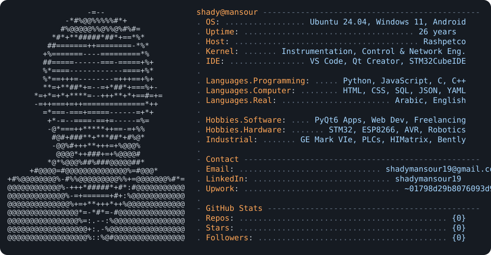

<!-- ===== HERO (your neofetch card) ===== -->

  

  

  
  
  
  
  

---

### 👋 About me

I'm an **Instrumentation, Control & Network Engineer** in oil & gas by day, and a **web developer** the rest of the time. I live between gas turbines and GitHub, so most of what I build solves real problems from the field: permits, handovers, timesheets.

- 🏭 Working on control & safety systems: GE Mark VIe, Siemens PCS7 / TIA Portal, Allen-Bradley, Bently Nevada 3500, HIMatrix
- 💻 Building web apps and freelancing on Upwork & Contra
- 💳 Working on a fintech contractor-financing platform at **Improvifi**
- 🔌 Embedded background: STM32, AVR, ESP8266, CAN / SPI / I²C / Modbus
- 📍 Egypt

---

### 🛠️ Tech stack

   
  

**Industrial & networking**

---

### 🚀 Featured projects

| Project | What it does | Stack | Links |
|---|---|---|---|
| ⏱️ **EMC Timesheet** | Engineers submit their days, the app builds the timesheet; admin reviews and exports to PDF/Excel | JS · Vercel | [Live](https://rashpetco-timesheet.vercel.app) · [Code](https://github.com/shadymansour19/Timesheet) |
| 🛒 **Hamada Supermarket** | Web app for a local supermarket | JS · Vercel | [Live](https://super-market-hamada.vercel.app) · [Code](https://github.com/shadymansour19/Supermarket-PriceBoard) |
| 📋 **Handover** | Work-permit and equipment tracking for an oil & gas facility | Apps Script · Sheets → Supabase | [Code](https://github.com/shadymansour19/handover) |
| 📈 **Miniscope** | Real-time serial plotter with FFT for STM32 data | C++ · Qt | [Code](https://github.com/shadymansour19/MiniScope) |

  
  

---

### 📊 GitHub stats

  
  

  

  

  <picture>
    <source media="(prefers-color-scheme: dark)" srcset="https://raw.githubusercontent.com/shadymansour19/shadymansour19/output/github-snake-dark.svg" />
    <source media="(prefers-color-scheme: light)" srcset="https://raw.githubusercontent.com/shadymansour19/shadymansour19/output/github-snake.svg" />
    
  </picture>

⚡ From field loops to code loops

